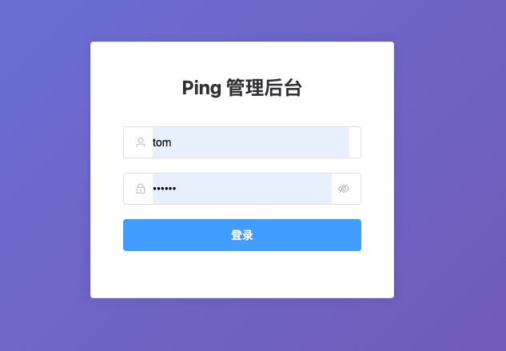
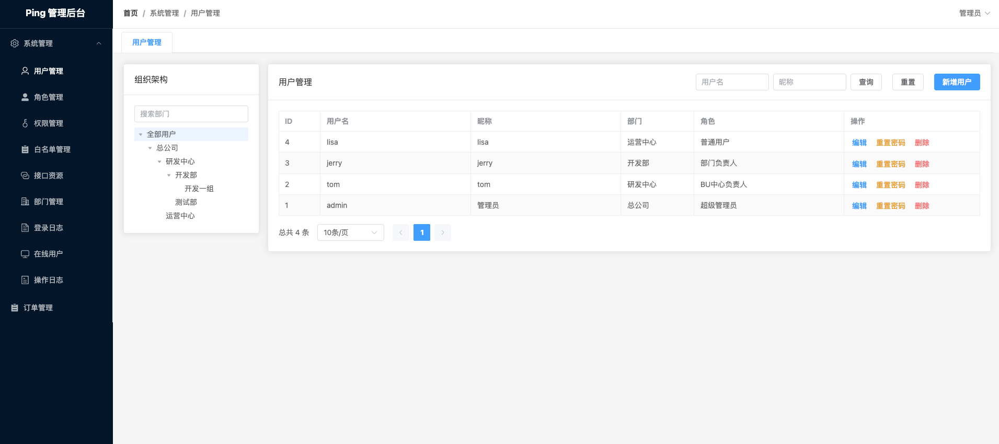

# ping-permission

Ping Permission — an RBAC permission foundation built on Spring Boot 4, Spring Cloud, Dubbo and Vue 3, easy to integrate and extend.

- Built-in RBAC, dual PC/App login domains, endpoint-level authorization, data permissions, auditing and online sessions.
- Menus and frontend routes come from the backend permission tree: a new page only needs one `sys_permission` row, and the frontend registers routes as `menu-{id}` instead of keeping a menu table.
- Permission logic lives only in `ping-user` and `ping-common`; cross-domain imports between PC, App, common and auth modules are rejected by `ModuleBoundaryTest`.
- `examples/ping-order` is an integration template: `order-service` depends only on `order-client`, `user-client` and the common starters, so duplicating those two modules is enough to add a business module.

## Screenshots

| Sign-in page | After sign-in (breadcrumbs + multi-tab) |
| --- | --- |
|  |  |

## Default accounts

Flyway seeds four backend accounts on first start, each with a different role and data scope — useful for exercising RBAC and data permissions:

| Account | Password | Role | Department | Data scope |
| --- | --- | --- | --- | --- |
| `admin` | `123456` | Super admin | HQ | All data |
| `tom` | `123456` | BU lead | R&D center | Own department and below (R&D center → Development / QA) |
| `jerry` | `123456` | Department lead | Development | Own department |
| `lisa` | `123456` | Regular user | Operations | Own records only |

> All four use `123456`. `lisa`'s V1 seed hash differed from the others, so `V2__reset_lisa_password.sql` resets it on startup — and only while the password still matches the original hash, so a password you already changed is never overwritten.
>
> These are PC (admin console) accounts. Mobile / consumer clients use a separate `app_user` system, signing up through `POST /user/app/auth/register`; accounts, tokens and annotations stay fully isolated.

## Who it's for

**Good fit:**

- **Teams with both a PC admin console and an App (consumer) login domain**: administrators and end users are separate account systems, and login, authorization and sessions should not interfere with each other.
- **Teams building admin consoles or internal platforms**: you need RBAC, menu/button/API permissions, department-scoped data access and audit logs.
- **Implementation teams doing ongoing customization**: the permission kernel is ready to use; copy the `examples/ping-order` template for new business services without touching the kernel.
- **Developers learning an end-to-end permission stack**: gateway authorization, Sa-Token dual login domains, Dubbo context propagation and MyBatis-Plus data permissions all run end to end in this project.

**Not a good fit:**

- Minimal single-service projects with no gateway or service registry: Nacos, Dubbo and Gateway add operational overhead.
- Teams outside the Java / Spring stack: this project is built on Spring Boot 4 + Spring Cloud + Dubbo.
- Teams expecting a ready-made low-code, workflow or reporting platform: this project provides a permission foundation plus a sample business module, not those capabilities.
- Projects requiring native multi-tenant isolation: the current model is a single database plus department data scope; there is no built-in `tenant_id` mechanism, so you would need to extend it.

## Project layout

This repository merges the five previously separate repositories into one project:

```
ping-permission/
├── pom.xml              # Maven aggregator (builds the 4 backend projects)
├── ping-common/         # Shared components: ping-core + web/dubbo/log/id/data-scope starters
├── ping-gateway/        # Spring Cloud Gateway (auth, authorization, routing, tracing)
├── ping-user/           # User & permission service (RBAC, login domains, audit, sessions)
│   ├── user-common/
│   ├── user-auth/
│   ├── user-pc/
│   ├── user-app/
│   ├── user-client/
│   └── user-service/
├── examples/            # Sample business modules (for illustration; copy or delete)
│   └── ping-order/
│       ├── order-client/
│       └── order-service/
├── ping-web/            # Frontend (Vue 3 + Vite + Element Plus)
├── init-sql/            # MySQL init scripts (nacos-mysql.sql; business tables come from Flyway migrations)
├── docker-compose.yml   # One-click orchestration
├── start.sh             # One-click build + start script (macOS / Linux / Git Bash)
├── start.ps1            # Windows PowerShell equivalent (same subcommands)
├── start.cmd            # Windows batch entry point (bypasses the PowerShell execution policy)
└── e2e-auth.sh          # End-to-end auth cases (login → gateway → service → data scope)
```

## Module documentation

Each module has its own README covering responsibilities, usage, examples and pitfalls:

| Module | Docs | Purpose |
| --- | --- | --- |
| Shared components | [ping-common](ping-common/README.en.md) | Core model and 5 Spring Boot starters |
| Gateway | [ping-gateway](ping-gateway/README.en.md) | Routing, authentication, endpoint authorization |
| User & permissions | [ping-user](ping-user/README.en.md) | Dual login domains, RBAC, data permissions, audit |
| Sample business | [examples](examples/README.en.md) | Index of sample business modules such as the order sample (copy or delete) |
| Frontend | [ping-web](ping-web/README.en.md) | Vue 3 admin console |

Submodules:

- `ping-common`: [ping-core](ping-common/ping-core/README.en.md), [ping-web-spring-boot-starter](ping-common/ping-web-spring-boot-starter/README.en.md), [ping-dubbo-spring-boot-starter](ping-common/ping-dubbo-spring-boot-starter/README.en.md), [ping-log-spring-boot-starter](ping-common/ping-log-spring-boot-starter/README.en.md), [ping-id-spring-boot-starter](ping-common/ping-id-spring-boot-starter/README.en.md), [ping-data-scope-spring-boot-starter](ping-common/ping-data-scope-spring-boot-starter/README.en.md)
- `ping-user`: [user-common](ping-user/user-common/README.en.md), [user-auth](ping-user/user-auth/README.en.md), [user-client](ping-user/user-client/README.en.md), [user-pc](ping-user/user-pc/README.en.md), [user-app](ping-user/user-app/README.en.md), [user-service](ping-user/user-service/README.en.md)
- `ping-gateway`: [gateway-service](ping-gateway/gateway-service/README.en.md)
- `examples/ping-order`: [order-client](examples/ping-order/order-client/README.en.md), [order-service](examples/ping-order/order-service/README.en.md)

## Requirements

| Component | Version |
| --- | --- |
| JDK | 21 |
| Maven | 3.9+ (optional: use the bundled `./mvnw`; `start.sh` falls back to it automatically) |
| Node.js | 20.19+ / 22.13+ (`ping-web`; required by ESLint 10) |
| MySQL | 8.x (database `ping`) |
| Redis | 7.x |
| Nacos | 2.x / 3.x (Docker setup uses 3.1.1) |

> The project targets **JDK 21**. If your default JDK is not 21, switch before building:
>
> ```bash
> # macOS
> export JAVA_HOME=$(/usr/libexec/java_home -v 21)
>
> # or for a single build
> JAVA_HOME=/path/to/jdk-21 mvn clean install -DskipTests
> ```

## One-click Docker setup

> Requires Docker Desktop (with Docker Compose v2), plus JDK 21 and Node.js on the host. If Maven is not installed, use the bundled `./mvnw`; `start.sh` falls back to it automatically.
> Builds run on the host; images only run the packaged artifacts, so dependencies are not re-downloaded inside containers.

```bash
chmod +x start.sh   # first time only
./start.sh          # build backend + frontend, then start everything
```

On first start it imports the Nacos schema/configuration (`init-sql/nacos-mysql.sql`), starts Redis/Nacos, and brings services up in health-check order. The business database `ping` is created by Flyway migrations that run when each service starts (`*/src/main/resources/db/migration/`; see [Default accounts](#default-accounts)).

| Entry point | Address |
| --- | --- |
| Frontend | http://localhost:5173 |
| Gateway API | http://localhost:9999 |
| API docs | http://localhost:9999/docs (Swagger UI, aggregates user-service and order-service) |
| Nacos console | http://localhost:18080 (Nacos 3.x serves the console at the root path; nacos/nacos when auth is enabled) |
| MySQL | localhost:13306 (root/123456, database `ping`) |
| Redis | localhost:16379 |

> **Login endpoints**: the admin console uses `POST /user/pc/auth/login` (username + password); mobile / consumer clients use `POST /user/app/auth/login` (phone + password). After login, the response body contains a `token` field — send it back as the `ping-token: Bearer <token>` header on all subsequent requests so the gateway can verify identity and interface permissions. Accounts, tokens and annotations are fully isolated — see [ping-user/README.en.md](ping-user/README.en.md#22-the-pc-login-domain-and-app-login-domain-use-two-sets-of-tokens).

  ```bash
  # Example: login with curl and extract the token (admin / 123456)
  TOKEN=$(curl -sS -X POST http://localhost:9999/user/pc/auth/login \
      -H 'Content-Type: application/json' \
      -d '{"username":"admin","password":"123456"}' | python3 -c "import sys,json; print(json.load(sys.stdin)['data']['token'])")
  echo "token = $TOKEN"

  # Call a protected endpoint with the ping-token header
  curl -sS http://localhost:9999/user/pc/sys/user/list -H "ping-token: Bearer $TOKEN"
  ```

```bash
./start.sh --skip-build   # start with existing target/*.jar and ping-web/dist
./start.sh logs           # tail all logs (optionally: ./start.sh logs gateway)
./start.sh status         # container status
./start.sh restart        # restart all containers
./start.sh down           # stop and remove containers (volumes kept)
./start.sh clean          # stop and remove volumes (database re-initialises next start)
```

- `.env` (optional): centralises startup settings such as `APP_ENV`, host ports, the MySQL password and Nacos auth; `start.sh` and Docker Compose read it automatically, and every value has a default so the file can be omitted.
- Host ports avoid the usual MySQL/Redis/Nacos ports to prevent conflicts with local services. Copy `.env.example` to `.env` to change them (stop or re-map your local `npm run dev` / gateway if 5173 or 9999 are already in use).
- Orchestration lives in the root `docker-compose.yml`. The web image (`ping-web/Dockerfile` + `nginx.conf`) serves the SPA and proxies `/api` to the gateway's `/user/pc` route.
- Startup order: `mysql/redis/nacos` → `user-service/order-service` → `gateway` → `web`, all gated by health checks.

### Windows (PowerShell)

Same subcommands as `start.sh`; no Git Bash or WSL required:

```powershell
.\start.ps1              # build backend + frontend, then start
.\start.ps1 --skip-build
.\start.ps1 logs gateway
.\start.ps1 down
```

- Builds use `mvnw.cmd` and `npm.cmd`; if Maven is missing it falls back to the bundled wrapper;
- If PowerShell blocks the script, use `start.cmd` (it adds `-ExecutionPolicy Bypass`) or run `powershell -ExecutionPolicy Bypass -File .\start.ps1`;
- Still requires JDK 21, Node.js 20.19+ / 22.13+ and a running Docker Desktop (Linux containers).

## Build

```bash
# Backend: build every module from the repository root
mvn clean install -DskipTests

# Run a single service (run the install above first; do not add -am,
# otherwise Spring Boot runs on the aggregator and fails with "no main class")
mvn -pl ping-user/user-service spring-boot:run
mvn -pl ping-gateway/gateway-service spring-boot:run
mvn -pl examples/ping-order/order-service spring-boot:run

# The config namespace follows APP_ENV (dev by default); to use the public namespace:
# NACOS_CONFIG_NAMESPACE="" mvn -pl ping-user/user-service spring-boot:run

# Frontend
cd ping-web
npm install
npm run dev
```

> **No Maven installed?** Replace `mvn` with `./mvnw` (or `mvnw.cmd` on Windows): the wrapper pins 3.9.14 via `.mvn/wrapper/maven-wrapper.properties` and downloads it on first run (network required). `./start.sh` already falls back to it.
>
> **The version has a single source**: `<revision>` in the root `pom.xml`. Child modules reference it via
> `<parent><version>${revision}</version>`, `start.sh` reads the same value for Docker image tags
> (`./start.sh version` prints it), and release tags should match. Bumping a release means editing that one line;
> `flatten-maven-plugin` resolves `${revision}` to a concrete version on `install` / `deploy`.

## Tests

```bash
# Unit + integration tests (integration tests start a MySQL container via Testcontainers; Docker required)
mvn verify

# Unit tests only: no Nacos / MySQL / Redis required
mvn test

# A single module
mvn test -pl ping-common/ping-core

# A single integration test class
mvn verify -pl ping-user/user-service -Dit.test=UserSchemaMigrationIT

# Full Spring context test (Nacos / MySQL / Redis must be running)
PING_IT=true mvn test -pl ping-user/user-service -am

# End-to-end auth cases (the whole stack must be running: run ./start.sh first)
./e2e-auth.sh
```

Tests come in four layers:

| Layer | Naming | Runner | Requires |
| --- | --- | --- | --- |
| Unit tests | `*Test.java` | surefire, `mvn test` / `mvn verify` | nothing external |
| Integration tests | `*IT.java` | failsafe, `mvn verify` only | Docker (Testcontainers); skipped automatically without Docker |
| Context tests | `*ApplicationTests.java` | surefire, needs `PING_IT=true` | Nacos / MySQL / Redis; skipped by default |
| End-to-end auth | `e2e-auth.sh` | CI job `E2E / auth chain`; run manually locally | the running stack (Nacos / MySQL / Redis / gateway) |

Unit tests cover permission matching, data-scope SQL rewriting, login lockout, gateway path normalisation and whitelisting, the order state machine, order access control, and the five user-pc service classes (permission, user, role, department, data scope) with Mockito-isolated mappers and no Spring context.

The integration tests (`UserSchemaMigrationIT`, `OrderSchemaMigrationIT`) run the Flyway migrations against a real `mysql:8.0` container and verify:

- an empty database gets every table and exactly the seed rows shipped in V1;
- restarting does not re-run the migration or duplicate seed data;
- a pre-existing schema without a history table is baselined at 0, then V1 runs and existing tables survive;
- two services sharing the `ping` database each write only their own `flyway_schema_history_*` table.

After changing a migration script, run `mvn verify`; when you add tables or seed rows, update the expected values in the matching `*SchemaMigrationIT`.

`e2e-auth.sh` exercises the real path (gateway → Dubbo → user-service → MySQL) and catches wiring problems that unit tests cannot:

- no token or a forged token is always rejected with 401;
- `admin` / `tom` can log in and receive a token for the `ping-token` header;
- gateway endpoint rules (loaded from `sys_api_resource` over Dubbo) work: 200 with the permission code, 403 without it;
- an endpoint missing from `sys_api_resource` returns 403 (fail-closed), so a forgotten registration fails fast;
- the same user-list endpoint returns different row counts and departments for two accounts with different data scopes;
- after logout the old token gets 401 immediately and other sessions are unaffected.

Register new endpoints in `sys_api_resource`, and add an assertion to `e2e-auth.sh` when it matters. The script waits for the chain to become ready first (180s by default, tune with `E2E_READY_TIMEOUT`).

## Code style

Backend code follows the [Alibaba Java Coding Guidelines](https://github.com/alibaba/p3c). The `ali-p3c` Maven profile wires in the official `p3c-pmd` rulesets without changing the default build:

```bash
# Report only: target/pmd.xml in each module
mvn -Pali-p3c pmd:pmd

# Fail on any violation (used by the CI gate)
# the compile phase is required: on its own, pmd:check does not use the reactor output
# and tries to resolve inter-module dependencies from the local repository
mvn -Pali-p3c compile pmd:check
```

Every module currently reports 0 violations; run the check above before submitting new code.

The frontend uses ESLint with a flat config (`ping-web/eslint.config.js`): `eslint-plugin-vue`'s `flat/essential` plus `@eslint/js` recommended rules. It catches runtime-level mistakes (undefined variables, missing `:key`, mutating props) and deliberately skips formatting rules:

```bash
cd ping-web
npm run lint      # CI gate
npm run lint:fix  # fix what can be fixed automatically
```

## CI

`.github/workflows/ci.yml` (GitHub Actions) runs on pushes and pull requests targeting `master` / `develop`. Any failing job blocks the change:

| Job | Command | Purpose |
| --- | --- | --- |
| Backend | `mvn -B verify` | Compile, unit tests, integration tests (Testcontainers starts MySQL), package, JaCoCo coverage |
| End-to-end auth | `docker compose up` + `./e2e-auth.sh` | Brings up the real Nacos / MySQL / Redis / services / gateway and verifies login → gateway authorization → service authorization → data scope |
| Code style | `mvn -B -Pali-p3c compile pmd:check` | Alibaba Java coding guidelines (p3c-pmd); fails on any violation |
| Frontend | `npm ci && npm run lint && npm run build` | Install from the lockfile, lint, then build `ping-web` |
| Dependency scan | Trivy `fs` | Block on fixable HIGH/CRITICAL vulnerabilities |

Surefire / Failsafe results and `target/site/jacoco` coverage reports are uploaded as build artifacts, and failing tests are published to the pull request checks.
GitHub Actions runners ship with Docker, so `*IT.java` runs for real there; locally, without Docker, those tests skip and `mvn verify` still passes.
When the end-to-end job fails it prints the tail of every container log, which usually points straight at a config, routing or data problem.
`PING_IT` context tests need the whole Nacos/MySQL/Redis stack and are not part of CI; run them locally against the Docker stack when needed.

> GitHub Actions does not run on a Gitee-hosted repository. Use the root `ci.sh` in a Gitee Go `build@maven` step, or invoke it from any other CI system.

Reproduce CI locally:

```bash
./ci.sh                    # backend, code style, frontend, dependency scan
SKIP_TRIVY=1 ./ci.sh       # skip the scan when Trivy is not installed
E2E=1 ./ci.sh              # also run the end-to-end auth cases (start the stack first)
```

> If a finding is confirmed non-exploitable, add it to `.trivyignore` with a reason and an expiry date.

## Local ports

| Service | Port |
| --- | --- |
| ping-gateway | 9999 (management 8081) |
| ping-user / user-service | 8099 |
| examples/ping-order / order-service | 8100 (management 8102) |
| ping-web (Vite) | 5173, proxies `/api` to the gateway at `http://localhost:9999` |

## Configuration (Nacos config center)

Each service's `src/main/resources/application.yml` keeps only **bootstrap settings** (service name, Nacos address, config import). Runtime configuration is stored in Nacos's MySQL database and initialised by `init-sql/nacos-mysql.sql`:

```
init-sql/
└── nacos-mysql.sql                        # Nacos database nacos_config: schema + configuration data
```

The business database `ping` is not in `init-sql/`; it is created by the Flyway migrations each service runs at startup (see "Database migrations" below).

Configurations in the `nacos_config` database:

| dataId | Contents |
| --- | --- |
| `application-{dev,test,prod}.yml` | Shared: Redis, Sa-Token, Dubbo registry, Actuator, graceful shutdown |
| `gateway-service-{dev,test,prod}.yml` | Gateway: ports, routes, Sa-Token whitelist/permission rules |
| `user-service-{dev,test,prod}.yml` | User service: port, datasource, MyBatis-Plus, Dubbo provider, login policy |
| `order-service-{dev,test,prod}.yml` | Order service: port, Dubbo provider, Actuator |

- dataId = file name, group = `DEFAULT_GROUP`; applications read the default namespace.
- Nacos uses MySQL storage (database `nacos_config`). `nacos-mysql.sql` is mounted into the MySQL container's `/docker-entrypoint-initdb.d/` and **imported on first start (empty volume)**, before Nacos starts.
- The dump also keeps copies of the local Nacos `public` / `dev` / `test` / `prod` namespaces; the Docker services read the default namespace, while those copies serve local Nacos setups.
- Startup imports `application-${APP_ENV}.yml` and `${spring.application.name}-${APP_ENV}.yml`; a missing config fails fast instead of running half-configured.
- `APP_ENV` selects the environment (default `dev`) and is also used as the discovery namespace (`dev`/`test`/`prod`); Dubbo uses `dubbo-${env}`.
- dev/test/prod are identical for now; change them per environment in the Nacos console.

### Updating configuration

Configuration is no longer kept in repository yml files. To change it:

1. Open the Nacos console (http://localhost:18080), edit the relevant dataId and publish.
2. Re-export `nacos_config` so the next fresh start uses the latest configuration:

   ```bash
   docker exec ping-mysql sh -c 'mysqldump -uroot -p"$MYSQL_ROOT_PASSWORD" --databases nacos_config \
     --single-transaction --no-tablespaces --set-gtid-purged=OFF \
     --default-character-set=utf8mb4 --skip-add-locks' > init-sql/nacos-mysql.sql
   ```

   > Existing MySQL volumes do not re-run init scripts. After updating the SQL, run `./start.sh clean` or import manually into `nacos_config`.

### Switching environments

```bash
# Docker
APP_ENV=test ./start.sh

# Single service locally
APP_ENV=test mvn -pl ping-gateway/gateway-service spring-boot:run
```

> This is a clean version: no Helm charts yet (Kubernetes deployment is on the roadmap). CI is defined in `.github/workflows/ci.yml`, and the same gates can be run anywhere via `./ci.sh`; each service keeps its own `Dockerfile` and start scripts.
> Maven versions are centralised in the root `pom.xml` under `<properties>` and `<dependencyManagement>`; child modules declare no versions, and the project's own version lives only in the root POM's `<revision>`.

## API docs (Swagger UI)

Open **http://localhost:9999/docs** after startup; the top-right selector switches between the user-service and order-service specs.

- **Served by the gateway**: services only expose OpenAPI JSON (`/v3/api-docs`); the UI is provided centrally and service ports are not published to the host.
- **New endpoints are picked up automatically**: springdoc derives parameters and response schemas from controller signatures and DTOs. Add `@Tag(name = "...")` on a controller to get a readable group name.
- **Authenticated calls**: the auth header is `ping-token` with value `Bearer <token>`. Call `/user/pc/auth/login` (admin) or `/user/app/auth/login` (mobile) first, then use **Authorize** in the UI.
- **Base URL**: `servers` is pinned to `${PUBLIC_BASE_URL:http://localhost:9999}` so it does not show the container-internal IP. Override `PUBLIC_BASE_URL` when the gateway port, hostname or reverse proxy differs.
- **Disabled in production**: `springdoc.*.enabled=false` in the prod configs, and the gateway adds neither the docs routes nor the permit entries. Do not enable it in prod — it exposes the full API surface.
- **Local IDE**: services expose JSON only, at `http://localhost:8099/v3/api-docs`; set `springdoc.swagger-ui.enabled=true` temporarily if you want the UI on a service port.

## Database migrations (Flyway)

The schema and seed data of the business database `ping` are owned by Flyway migrations that run when each service starts, rather than by a single full SQL init script:

```
ping-user/user-service/src/main/resources/db/migration/V1__init_user_schema.sql
examples/ping-order/order-service/src/main/resources/db/migration/V1__init_order_schema.sql
```

Conventions:

- **V1 is an idempotent baseline**, written with `CREATE TABLE IF NOT EXISTS` + `INSERT IGNORE`, so it runs both on a fresh database and on an existing one.
- **One history table per service**: `spring.flyway.table` is `flyway_schema_history_user` / `flyway_schema_history_order`. Services sharing the `ping` schema never interfere with each other's migrations.
- **`baseline-on-migrate: true` + `baseline-version: 0`**: a database that already has data is baselined at 0 and then still runs V1, avoiding the "non-empty schema, skip table creation" trap.
- **Applied migrations are read-only**: add `V2__xxx.sql` for schema changes instead of editing V1.
- **Clean is disabled**: `clean-disabled: true` prevents accidental data loss.
- **gateway-service is excluded**: it only uses Redis and Dubbo and has no JDBC datasource.

To add tables or columns, drop a new versioned file into that service's `db/migration` directory and restart the service. If a migration fails (MySQL DDL is not transactional), the history table keeps a `success=0` row; fix the cause, then `DELETE FROM flyway_schema_history_xxx WHERE success=0` (equivalent to `flyway repair`) and restart.

## Roadmap

> These are directions without a fixed schedule; priority follows issue feedback. Released changes live in [CHANGELOG.md](CHANGELOG.md).

| Area | Description |
| --- | --- |
| Multi-tenancy | `tenant_id` with tenant-level isolation across permissions, data scope and sessions (today: single database + department data scope) |
| CI/CD | Dependency automation (Dependabot, grouped for Maven / npm / GitHub Actions) and a JaCoCo `check` coverage gate; tag-driven image builds → Helm chart release → Kubernetes deployment (namespaces, health probes, externalized config) |
| App domain parity | Unit tests and e2e assertions for `user-app`, plus login lockout / captcha / login audit |
| Migration operations | Flyway `dryRun` and rollback guidance to lower production change risk |
| Error codes and reuse | Unified error codes (replacing the current `RuntimeException` messages) and extracting `ApiCoverageChecker` into a reusable starter |
| Frontend and mobile | Frontend TypeScript / component tests; a uni-app x mobile sample (login + profile) |

## Contributing

| Document | Purpose |
| --- | --- |
| [CONTRIBUTING.md](CONTRIBUTING.md) | Branch model, commit conventions, testing requirements, database change rules, release process (Chinese) |
| [CODE_OF_CONDUCT.md](CODE_OF_CONDUCT.md) | Code of conduct (Chinese) |
| [SECURITY.md](SECURITY.md) | How to report vulnerabilities, response times, and **defaults you must change before deploying** (Chinese) |
| [CHANGELOG.md](CHANGELOG.md) | Release notes (Chinese) |

Run `./ci.sh` (or `mvn verify` + `mvn -Pali-p3c compile pmd:check`) before opening a pull request.
In short: branch off `develop` → commit using Conventional Commits → open a PR that references an issue → merge once CI is green.

## License

Released under the [Apache License 2.0](LICENSE).
